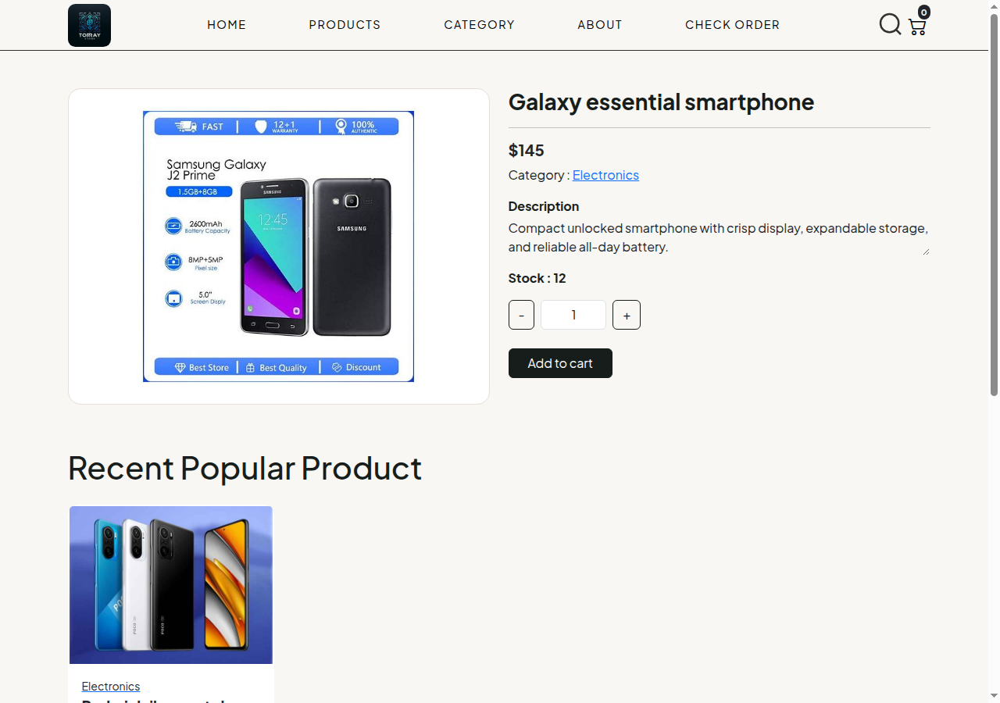
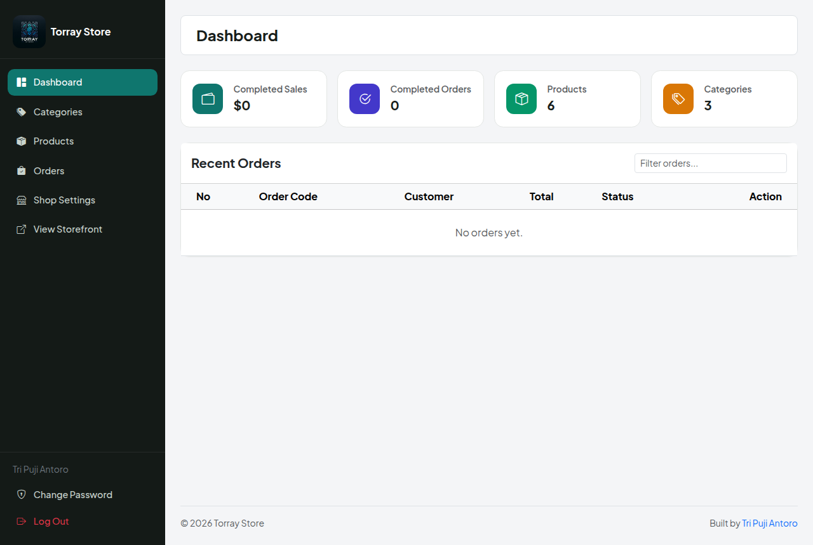
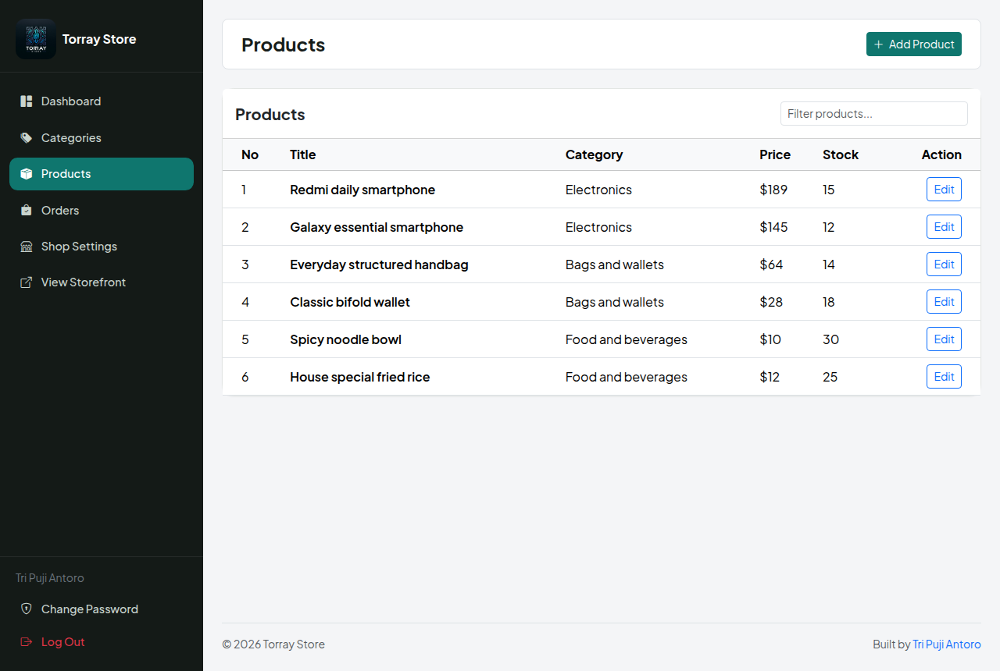

# Torray Store

Full-stack e-commerce storefront and merchant operations console built with **Laravel 9**, **Bootstrap 5**, and **Vanilla JavaScript**.

## Preview

| Storefront Landing (`/`) | Product Detail & Cart (`/product/{slug}`) |
| :---: | :---: |
|  |  |

| Merchant Dashboard (`/home`) | Product Catalog Console (`/admin/products`) |
| :---: | :---: |
|  |  |

## Key Capabilities

- **Storefront & Catalog**: Responsive landing page, category filtering, keyword product search, and interactive multi-image product gallery with zoom.
- **Session Cart & Transactional Checkout**: Stock-validated cart updates via Fetch API and database-transactional checkout (`DB::transaction` + row locking) that computes totals directly from database pricing.
- **Order Tracking**: Public customer order lookup by generated order code (`XXXX-YYYYMMDD`).
- **Merchant Console**: Protected dashboard with real-time order metrics, category and product CRUD, multi-image gallery uploader, shop profile management, and status-driven inventory adjustment.
- **Single-Owner Setup**: Initial registration automatically closes once the first administrator account is created.

## Tech Stack

- **Backend**: PHP 8+, Laravel 9, Eloquent ORM, MySQL / SQLite
- **Frontend**: Blade Components, Bootstrap 5.3, Bootstrap Icons, Custom CSS (`torray-store.css`, `torray-admin.css`), Vanilla JS (`torray-ui.js`)
- **Testing & CI**: PHPUnit Feature & Unit tests on SQLite `:memory:` via GitHub Actions

## Getting Started

1. **Install PHP dependencies**

   ```bash
   composer install
   ```

2. **Configure environment**

   ```bash
   cp .env.example .env
   php artisan key:generate
   ```

   Update `DB_DATABASE`, `DB_USERNAME`, and `DB_PASSWORD` in `.env` for your local MySQL instance.

3. **Run migrations & seed demo catalog**

   ```bash
   php artisan migrate --seed
   ```

   Default seeded admin credentials:
   - Email: `admin@torraystore.com`
   - Password: `password`

4. **Serve locally**

   ```bash
   php artisan serve
   ```

## Running Tests

```bash
php artisan test
```
